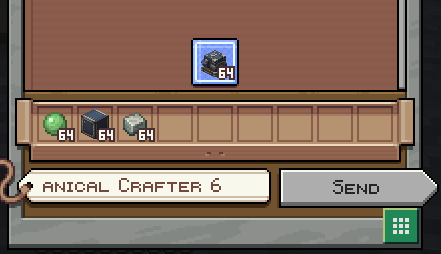
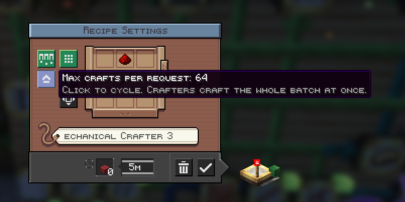
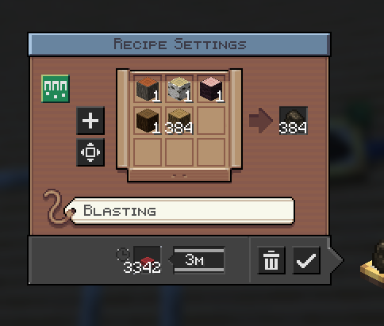

# Create: Smart Bulk Factory

Addon for **Create 6.0.x** (NeoForge 1.21.1). Install on both client and server.

Create crafts one item at a time: a Factory Gauge asks for a single craft per cycle and a Mechanical Crafter takes one
item per slot. This addon lets them work in bulk, like shift-clicking in a crafting table.

## Features

### Bulk crafting (Factory Gauges **and** Stock Keeper)
Works the same whether the order comes from a **Factory Gauge** in crafting mode or from the **Stock Keeper**
(order a craftable item, e.g. 64 crafts). The package carries the whole batch, Mechanical Crafters receive N items per
slot and craft all N crafts in one pass. Remainders (buckets...) scale with the batch.
Also works with Create: Extra Gauges' expanded (bigger than 3x3) crafting.

### Max crafts per request
In crafting mode every gauge gets a button on the left of the Recipe Settings window. Click to cycle
1, 2, 4, 8, 16, 32, 64: the most crafts that gauge will request at once. A server config (`maxBatchCrafts`) caps it globally.

### Connected alternatives (variants)
Toggle button next to it. When ON, connect extra input gauges to a gauge and they become the **only** alternatives it
may use, for example 3 kinds of logs out of the 6 in the system. If the main ingredient runs out, the gauge switches to
a connected alternative instead of stalling. Nothing is used unless you connect it yourself.
Works for crafting recipes and for other recipes such as blasting (logs to charcoal).

## Limits
A batch must fit one package (9 slots), respect ingredient stack size, and the result must fit one stack.
Bulk crafting needs a Repackager feeding the Mechanical Crafters, as in normal Create setups.

## Building
`./gradlew build` (needs `libs/create-1.21.1-6.0.10.jar`, not included).

MIT licensed.
